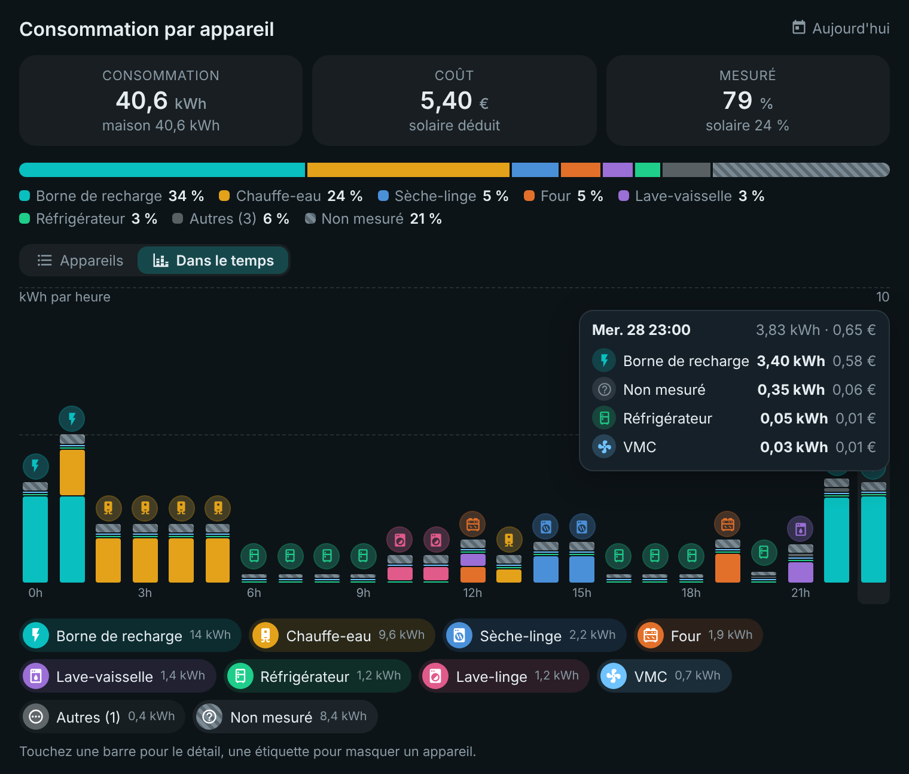
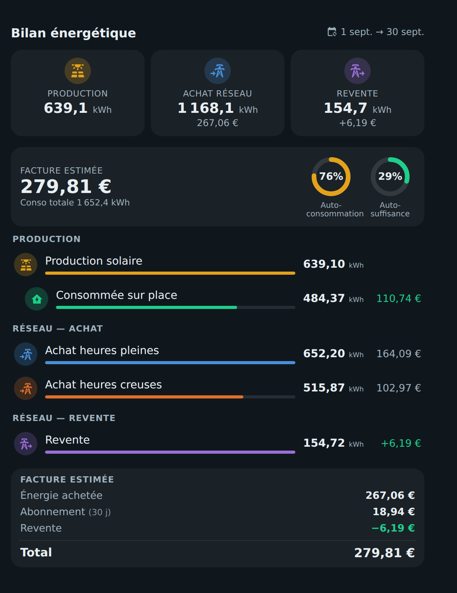
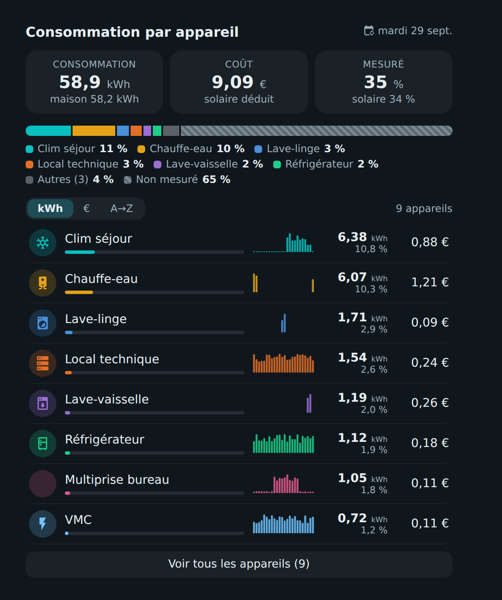
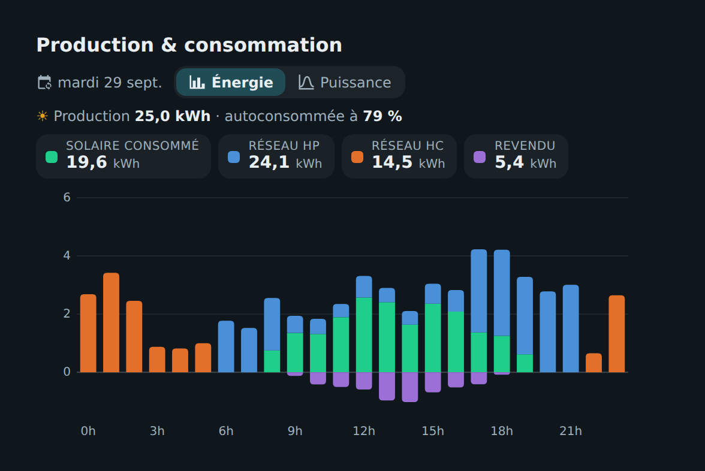
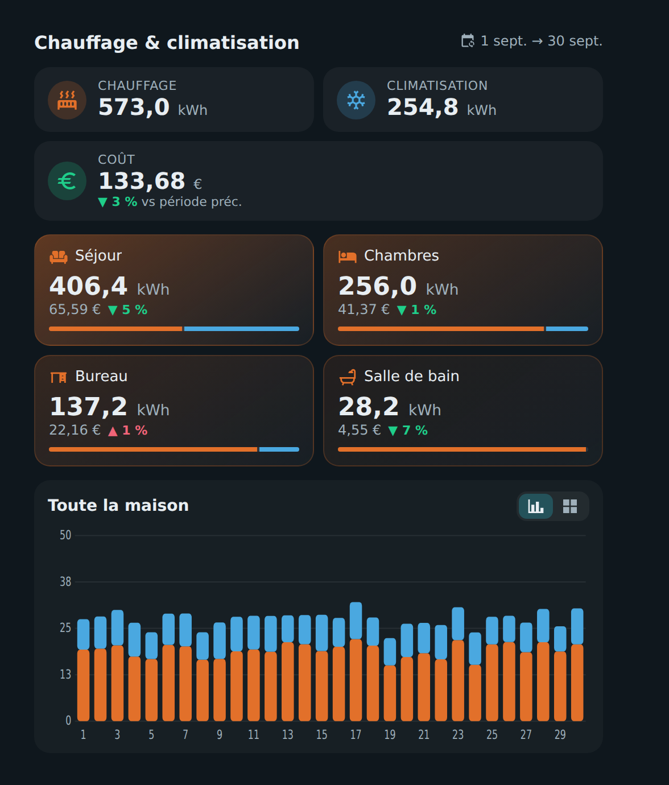
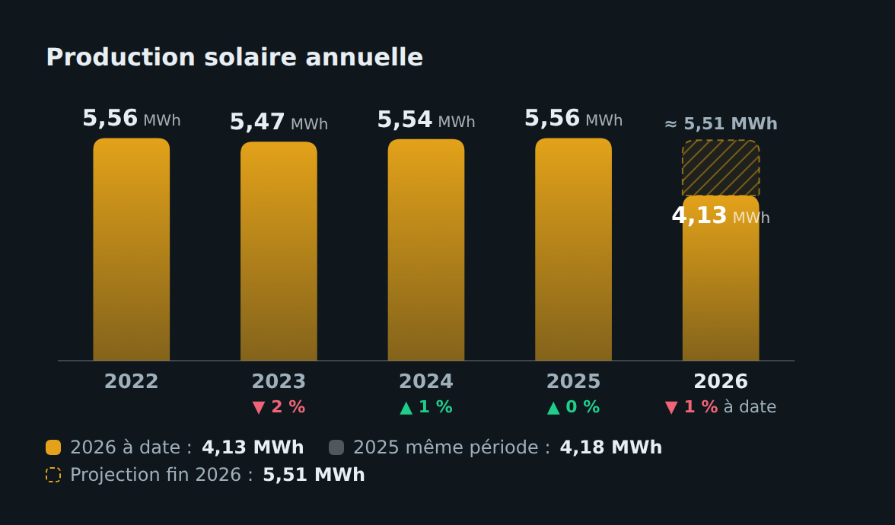
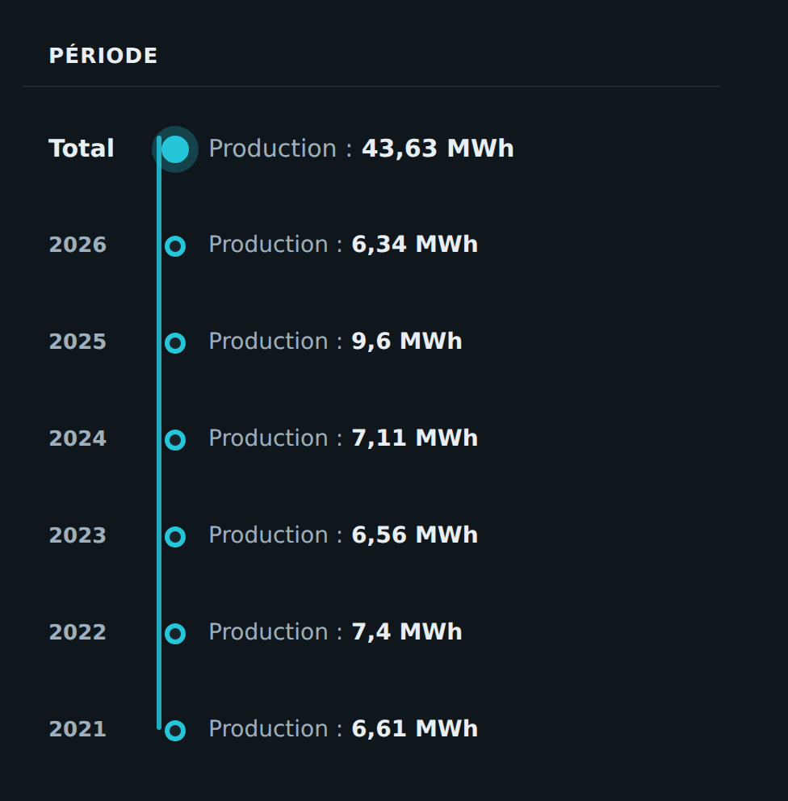

# ⚡ HOLM Energy Cards

[](https://hacs.xyz/)


[🇫🇷 Français](README.md) · 🇬🇧 English

**Six cards to understand your energy: what you produce, buy and export, what each device costs, heating room by room, and the trend year after year.**

HOLM Energy Cards builds on the Home Assistant **Energy dashboard**: sources, devices and prices are picked up automatically. The cards follow the Energy dashboard's **date picker** (day, week, month, year), like the official cards.

> ✨ **One file, six cards**, all set up in the visual editor (except Yearly totals, in YAML).

| Card | Type | What it shows |
|---|---|---|
| [Energy balance](#-energy-balance) | `custom:holm-energy-sources-card` | Production, import, export, self-consumption, self-sufficiency, estimated bill |
| [Consumption per device](#-consumption-per-device) | `custom:holm-energy-devices-card` | kWh, cost and share of each device, with the “unmeasured” part and a chart per device |
| [Production & consumption](#-production--consumption) | `custom:holm-solar-chart-card` | Energy (bars) and power (curve) chart of solar and grid |
| [Heating & air conditioning](#-heating--air-conditioning) | `custom:holm-climate-energy-card` | Heating and A/C per room, cost, trend, chart or calendar |
| [Energy per year](#-energy-per-year) | `custom:holm-year-bars-card` | Yearly bars, “to date” comparison and projection of the year |
| [Yearly totals](#-yearly-totals) | `custom:holm-energy-years-card` | Total and years of a statistic, as a vertical timeline |

*Screenshots in French — the cards follow the language of your Home Assistant profile.*

### 🆕 What's new in 1.4.0

Thanks to Lheriss for these three ideas. Nothing changes for an existing setup in euros, with a standard grid meter and electric heating.

- 💱 **Home Assistant's currency** (#6): amounts show in the currency set in Settings → System → General (“CHF 2.30”, “$2.30”…), with a matching icon. `currency` option to force one. See [Currency](#-currency).
- 🔁 **Inverted grid power or two sensors** (#7): in *Production & consumption*, the Power view follows every grid power setting of the Energy dashboard (standard, inverted or two sensors), using the original sensors and their whole history. New `grid_power_invert`, `grid_power_import` and `grid_power_export` options. See [Grid power](#grid-power).
- 🔥 **Non-electric heating** (#8): in *Heating & air conditioning*, the cost of pellet, gas or oil heating comes from its Energy dashboard gas source, or from the new room options `cost_entity` and `price`. The Air conditioning tile hides itself when no room has air conditioning (`show_cooling` option). See [Cost of non-electric heating](#cost-of-non-electric-heating).

### What's new in 1.3.0

- 🌍 **The six cards speak 8 languages**: English, French, German, Spanish, Italian, Dutch, Portuguese and Polish, editors and charts included. They follow the language of your Home Assistant profile (English if your language isn't translated yet); the `language` option, available on every card, lets you force one. Numbers and dates follow the language too.
- Default titles (“Energy balance”, “Consumption per device”…) are translated as well, even when saved in the configuration.

### What's new in 1.2.2

**🧾 Subscription and taxes read from [HOLM HP/HC](https://github.com/kaaribou/holm-tarif).** If the HOLM HP/HC integration is installed, *Energy balance*, *Consumption per device* and *Heating & air conditioning* read the monthly subscription, the CSPE / excise, the TCFE and the export tax from it automatically (French electricity taxes). Values set in a card take priority, and `holm_tarif: false` turns automatic reading off.

**🩹 No more error when adding a card.** A freshly added card (no entity chosen yet) or an Energy dashboard not yet configured used to show `Error: length of value must be at least 1 at 'statistic_ids'`. The card now simply says what to do.

### What's new in 1.2.1

**💶 Correct costs with Tempo and changing prices.** The cards now use the **costs recorded by Home Assistant** for each Energy dashboard source, computed hour by hour at the price of the moment, like the official Energy dashboard. Before, when a source had a price entity, the card applied the **current** price to the whole history: with variable tariffs (such as EDF Tempo) or after a price change, past costs were wrong.

### What's new in 1.2.0

**🕒 “Over time” view.** *Consumption per device* can show all devices in **a single chart**: bars stacked by hour, day or month, with **the icon of the biggest consumer** above each bar.



- hover (or tap) a bar: details per device;
- clickable legend to hide or show a device;
- `view: timeline` and `timeline_devices` options (number of detailed devices, the others are grouped).

**💶 Correct cost in a device's chart**, recalculated hour by hour at the real price over the chart's period.

### What's new in 1.1.0

**📈 A chart for every device.** In *Consumption per device*, tap a device to open its chart: **24 h · 7 d · 30 d · 12 months** or **custom dates**, consumption bars, power curve on 24 h if the device has a power sensor, total, estimated cost, average and peak.

---

## Installation

### With HACS (recommended)

1. HACS → ⋮ menu → **Custom repositories**.
2. Add `https://github.com/kaaribou/holm-energy-cards`, category **Dashboard** (*Plugin*).
3. Search for the cards → **Download**.
4. Reload the page (Ctrl + F5).

### Manually

1. Copy `dist/holm-energy-cards.js` to `config/www/community/holm-energy-cards/`.
2. **Settings → Dashboards → ⋮ → Resources → Add**: `/local/community/holm-energy-cards/holm-energy-cards.js`, type **JavaScript module**.
3. Reload the page.

> [!NOTE]
> One resource loads all six cards. They then appear in the card picker (“HOLM – …”).

---

## 📊 Energy balance



- Solar production, grid imports (several tariffs, e.g. peak / off-peak) and export, with their cost.
- **Self-consumption** and **self-sufficiency** rings, share used on site and its value.
- **Estimated bill**: energy bought + subscription (prorated to the period) + taxes − export.

```yaml
type: custom:holm-energy-sources-card
items:
  - type: solar
    entity: sensor.solar_production
    name: Solar production
  - type: import
    entity: sensor.grid_peak
    name: Peak-hour import
    price: sensor.peak_price          # or cost_entity: cost statistic
  - type: import
    entity: sensor.grid_off_peak
    name: Off-peak import
    price: sensor.off_peak_price
  - type: export
    entity: sensor.grid_export
    name: Export
    price: 0.04
subscription: input_number.subscription
subscription_period: month
```

| Option | Description | Default |
|---|---|---|
| `language` | Language: `fr`, `en`, `de`, `es`, `it`, `nl`, `pt`, `pl` | the profile's |
| `items` | Sources: `type` (`solar`, `import`, `export`), `entity` (kWh), `name`, `cost_entity` or `price`, `color`, `icon` (**required**) | — |
| `subscription`, `subscription_period` | Subscription (number or entity) and its period (`month` / `year`) | HOLM HP/HC if installed |
| `taxes_import` | Taxes added to bought kWh (€/kWh, number or entities) | HOLM HP/HC if installed |
| `tax_export` | Tax deducted from exported kWh (€/kWh) | HOLM HP/HC if installed |
| `holm_tarif` | `false`: don't read the subscription and taxes from HOLM HP/HC | `true` |
| `self_price` | Value of a self-consumed kWh | average purchase price |
| `self_name` | Self-consumption label | `Used on site` |

## 🔌 Consumption per device



- Devices are read from **Settings → Dashboards → Energy → Individual devices** (or listed by hand).
- kWh, share and **cost** of each device, mini chart, sort by kWh, € or name, “Show all”.
- **Unmeasured**: what the home uses outside the tracked devices.
- **Real** cost (each hour's grid price, solar free), **grid** (as if everything came from the grid) or **fixed**.
- **Chart per device**: tap a device to open its consumption over 24 h, 7 d, 30 d, 12 months or custom dates, with total, cost, average and peak.
- **“Over time” view** (`view: timeline`): all devices stacked in one chart.

```yaml
type: custom:holm-energy-devices-card
cost_mode: real
top: 8
```

| Option | Description | Default |
|---|---|---|
| `view` | `list` (device list) or `timeline` (“Over time”) | `list` |
| `timeline_devices` | Devices detailed in the “Over time” view (the others are grouped) | `8` |
| `cost_mode` | `real`, `grid` or `fixed` | `real` |
| `price` | Fixed price (`fixed` mode), number or entity | — |
| `taxes_import` | Taxes added to the grid price (€/kWh) | HOLM HP/HC if installed |
| `holm_tarif` | `false`: don't read the taxes from HOLM HP/HC | `true` |
| `top` | Devices shown before “Show all” | `10` |
| `sort` | `kwh`, `eur` or `name` | `kwh` |
| `hide_zero`, `show_unmeasured`, `show_sparkline` | Hide devices at 0, show the unmeasured part, the mini charts | `true` |
| `exclude` | Devices to ignore | — |
| `devices` | Manual list: `entity`, `name`, `icon`, `color`, `power` (the power sensor adds the curve to the chart) | Energy dashboard devices |

## ☀️ Production & consumption



- **Energy** view: bars per hour (or day) of solar used, grid per tariff and export.
- **Power** view: production and consumption curves, with the **solar forecast** if configured in the Energy dashboard.
- Self-consumption rate of the period.

```yaml
type: custom:holm-solar-chart-card
mode: energy
```

| Option | Description | Default |
|---|---|---|
| `mode` | Default view: `energy` or `power` | `energy` |
| `show_tabs`, `show_forecast` | Energy / Power tabs, solar forecast | `true` |
| `solar_power`, `grid_power` | Power sensors | the Energy dashboard's |
| `grid_power_invert` | `true` if your `grid_power` sensor is **negative when importing** and positive when exporting | `false` |
| `grid_power_import`, `grid_power_export` | Two separate positive sensors, import and export, instead of `grid_power` | — |
| `solar_color`, `self_color`, `export_color`, `grid_colors`, `power_grid_color` | Colours | — |

### Grid power

The **Power** view draws grid power **above the axis when importing** and **below when exporting**. With no option, the card follows the grid power setting of the Energy dashboard, whatever its form:

- **a standard sensor**, positive when importing and negative when exporting: used as is;
- **an inverted sensor**, negative when importing (such as the SolarEdge M1 meter): its sign is flipped;
- **two separate sensors**, import and export, both positive: the card computes import − export.

In the last two cases, Home Assistant creates an intermediate sensor that starts with no history. The card reads **your original sensors** directly, with their whole history.

To choose yourself:

```yaml
# sensor negative when importing
grid_power: sensor.solaredge_m1_ac_power
grid_power_invert: true

# or two positive sensors
grid_power_import: sensor.grid_import_power
grid_power_export: sensor.grid_export_power
```

## 🌡️ Heating & air conditioning



- Heating and A/C totals, **cost** and change compared with the previous period.
- One tile per room with the heating / A/C split.
- **Bars** chart for the whole home, or **calendar** (heatmap).

```yaml
type: custom:holm-climate-energy-card
rooms:
  - name: Living room
    icon: mdi:sofa
    heating: sensor.living_room_heating_energy
    cooling: sensor.living_room_ac_energy
  - name: Bathroom
    icon: mdi:shower
    heating: sensor.towel_rail_energy
```

| Option | Description | Default |
|---|---|---|
| `rooms` | Rooms: `name`, `icon`, `heating`, `cooling` (kWh) (**required**), and for non-electric heating `cost_entity` or `price` (see below) | — |
| `cost_mode`, `price`, `taxes_import` | Cost calculation (see Consumption per device) | `real` |
| `compare` | Compare with the previous period | `true` |
| `view` | `bars` or `heatmap` | `bars` |
| `heat_color`, `cool_color` | Colours | orange / blue |
| `show_cooling` | Air conditioning tile: `true` (always), `false` (never); with no option, hidden when no room has `cooling` | automatic |

### Cost of non-electric heating

By default, heating and air conditioning are counted **at the electricity price** (see [Where do the prices come from?](#-where-do-the-prices-come-from)). For a pellet, gas or oil boiler, that price is wrong. A room's **heating** cost is taken, in this order:

1. `cost_entity`: a **cost statistic** (in your currency, only going up, like an Energy dashboard source's). The card uses its increase over the period;
2. `price`: a heating **price per kWh**, as a number or from an entity;
3. otherwise, if the `heating` entity is set as a **gas source in the Energy dashboard**, that source's cost: its cost statistic, the cost Home Assistant records for it, or its price;
4. otherwise, the electricity price, as before.

Air conditioning is always counted at the electricity price.

```yaml
rooms:
  - name: House
    icon: mdi:fire
    heating: sensor.pellets_energy            # Energy dashboard gas source: nothing else to do
  - name: Workshop
    icon: mdi:fire
    heating: sensor.stove_energy
    cost_entity: sensor.stove_total_cost       # or: price: 0.085
```

The `heating` entity must be in **kWh**. An Energy dashboard gas source measured in m³ does not fit: you need a sensor converted to kWh.

## 📅 Energy per year



- One bar per year, the change from one year to the next.
- Current year compared **to date** with the same period last year, and end-of-year **projection**.
- Uses long-term statistics: no helper to create.

```yaml
type: custom:holm-year-bars-card
entity: sensor.solar_production
title: Yearly solar production
start_year: 2022
color: "#e3a21a"
```

| Option | Description | Default |
|---|---|---|
| `entity` | Energy statistic in kWh (**required**) | — |
| `start_year` or `years` | First year, or number of years shown | all |
| `unit` | `auto`, `kWh` or `MWh` | `auto` |
| `color` | Bar colour | `#0ABFBF` |
| `show_projection` | Current year projection | `true` |

## 🧾 Yearly totals



A vertical timeline: the total since the start, then each year. Set up in YAML.

```yaml
type: custom:holm-energy-years-card
entity: sensor.solar_production
title: Period
label: Production
```

| Option | Description | Default |
|---|---|---|
| `entity` | Energy statistic (**required**) | — |
| `title`, `label` | Title and value label | `Period`, `Energy` |
| `color` | Timeline colour | theme colour |
| `start_year` | First year taken into account | `2000` |

All cards also accept `language` (`fr`, `en`, `de`, `es`, `it`, `nl`, `pt`, `pl`; the profile's by default), `show_frame: false` (no frame) and, for those following the date picker, `collection_key` if the dashboard has several.

## 💱 Currency

Amounts show in **Home Assistant's currency** (Settings → System → General → Currency): “€2.30”, “CHF 2.30”, “$2.30”… The cost icon follows the currency when one exists (€, $, £…), otherwise it is a banknote. The card does **no conversion**: amounts come from your sensors and prices, which are already in your currency.

To force a currency on a card: `currency: CHF` (3-letter code).

## 💶 Where do the prices come from?

The cards don't read your utility meters or a tariff of their own: they use the **grid sources of the Energy dashboard** (Settings → Dashboards → Energy), in this order:

1. the source's **cost statistic**, if you set one (“entity tracking the total costs”);
2. otherwise, the **cost Home Assistant records** for the source when it has a price (entity or number): `sensor.<source>_cost` and `sensor.<export>_compensation`. It is computed hour by hour at the price of the moment, so it is right with variable tariffs, peak / off-peak hours or a price change;
3. for hours older than that recorded cost, the current price × kWh.

*Consumption per device* and *Heating & air conditioning* derive a kWh price for each hour from it, applied to each device's kWh:

- `cost_mode: real`: the hour's grid cost ÷ home consumption. Solar is free, which lowers the average price;
- `cost_mode: grid`: the hour's grid cost ÷ kWh bought, as if everything came from the grid. This is the mode to pick to compare with per-tariff meters;
- `cost_mode: fixed`: the `price`.

The **taxes** (CSPE / excise, TCFE) and, in *Energy balance*, the **subscription** and **export tax** come from the card options or, failing that, from [HOLM HP/HC](https://github.com/kaaribou/holm-tarif) if installed.

In *Energy balance*, each source uses `cost_entity`, otherwise the cost recorded by Home Assistant for its entity, otherwise `price`. A fixed `price` (number) takes priority over the recorded cost.

---

## FAQ

| Problem | Solution |
|---|---|
| A card stays on “today” | Add an **Energy date picker** card (`energy-date-selection`) to the same view. |
| No devices or sources, or “Choose an entity…” | Choose the entities in the card editor, or set up the Home Assistant **Energy dashboard** first. |
| Costs are 0 | Set a price (entity or number) for your grid sources, in the Energy dashboard or in the card. |
| Costs don't match my peak / off-peak meters | See [Where do the prices come from?](#-where-do-the-prices-come-from): in `real` mode, solar counts as free; try `cost_mode: grid`. |
| No power curve in a device's chart | Link a power sensor to the device (Energy dashboard, or `power` in `devices`). |
| The cards are not in my language | Set `language` in the card, or open an issue to suggest a translation. |
| The new version doesn't show | Clear the cache (Ctrl + F5). |

---

## Say thanks?

Like the cards? You can buy me a beer 🍺

[](https://paypal.me/kaaribou)

---

## License

Code: **MIT** license — © kaaribou. See the [CHANGELOG](CHANGELOG.md) (in French).

Part of **HOLM — Home Orchestration & Living Management**: smart management and orchestration of the home.

Other projects: [Carburant HOLM](https://github.com/kaaribou/carburant-holm) · [Climat HOLM](https://github.com/kaaribou/climat-holm) · [Volets HOLM](https://github.com/kaaribou/volets-holm) · [HOLM HP/HC](https://github.com/kaaribou/holm-tarif) · [HOLM Lektrico](https://github.com/kaaribou/lektrico-holm) · [HOLM LaMetric](https://github.com/kaaribou/lametric-holm) · [HOLM My Menu](https://github.com/kaaribou/holm-mymenu) · [HOLM Cars](https://github.com/kaaribou/holm-cars) · [HOLM GitHub](https://github.com/kaaribou/github-holm) · [HOLM Navbar Card](https://github.com/kaaribou/holm-navbar-card) · [HOLM Climate Card](https://github.com/kaaribou/climate-card-holm) · [HOLM Music Card](https://github.com/kaaribou/holm-music-card) · [HOLM Power Flow Card](https://github.com/kaaribou/holm-power-flow-card) · [HOLM Ecojoko Card](https://github.com/kaaribou/holm-ecojoko-card) · [HOLM Runtime Card](https://github.com/kaaribou/holm-runtime-card) · [HOLM Covers Card](https://github.com/kaaribou/holm-covers-card) · [HOLM Floor Card](https://github.com/kaaribou/holm-floor-card) · [HOLM Radiator Card](https://github.com/kaaribou/holm-radiator-card) · [HOLM Security Card](https://github.com/kaaribou/holm-security-card) · [HOLM Sentinel Card](https://github.com/kaaribou/holm-sentinel-card) · [HOLM Recordings Card](https://github.com/kaaribou/holm-recordings-card) · [HOLM Smoke Card](https://github.com/kaaribou/holm-smoke-card) · [HOLM Family Card](https://github.com/kaaribou/holm-family-card) · [HOLM Govee Light Card](https://github.com/kaaribou/holm-govee-light-card) · [HOLM Leapmotor Card](https://github.com/kaaribou/holm-leapmotor-card).
