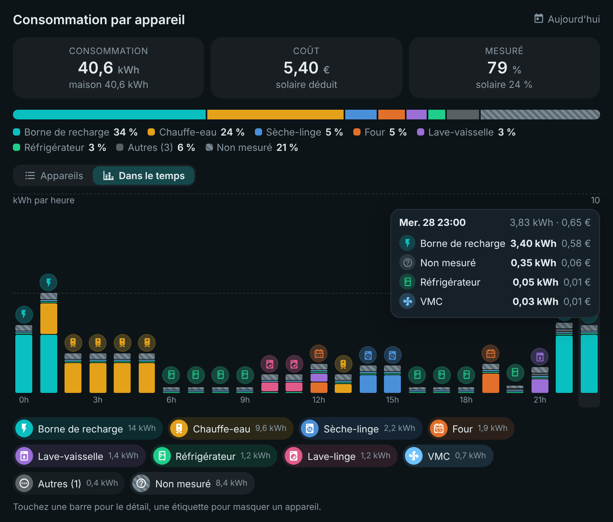
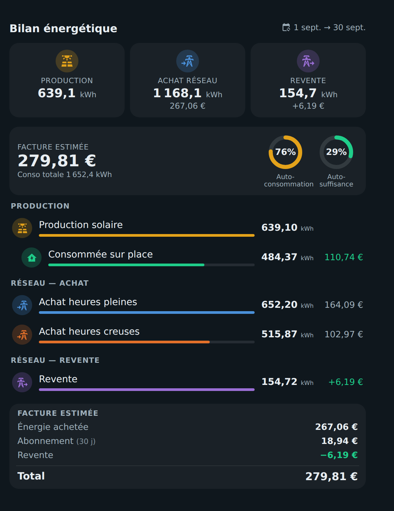
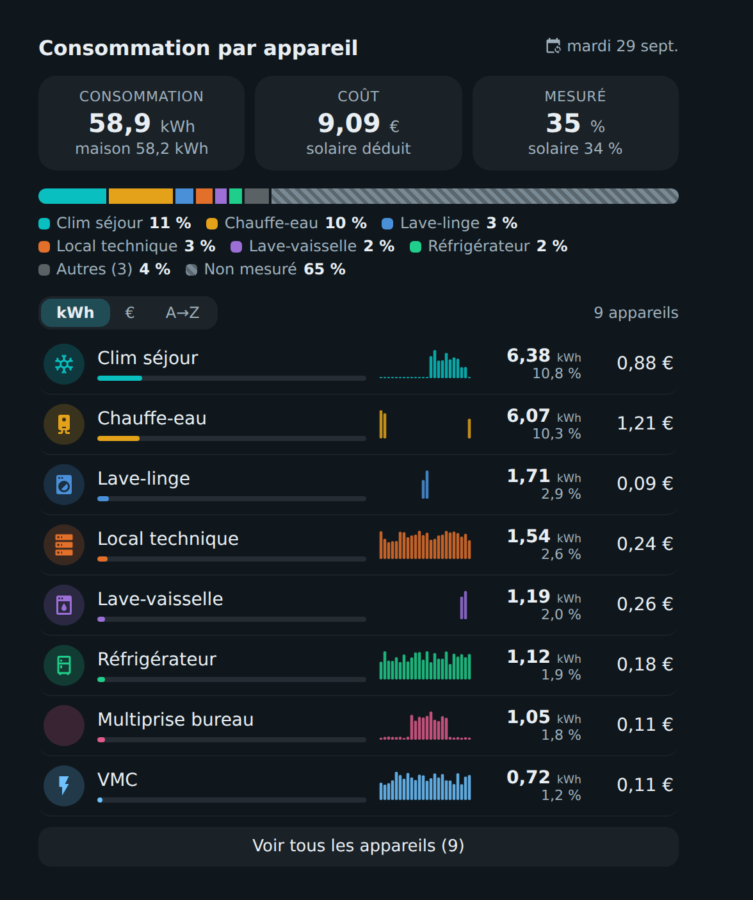
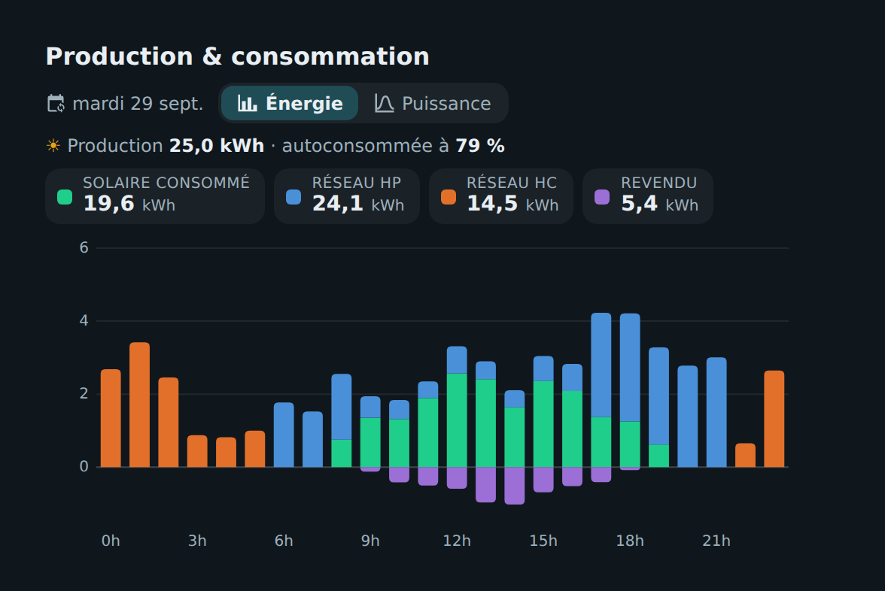
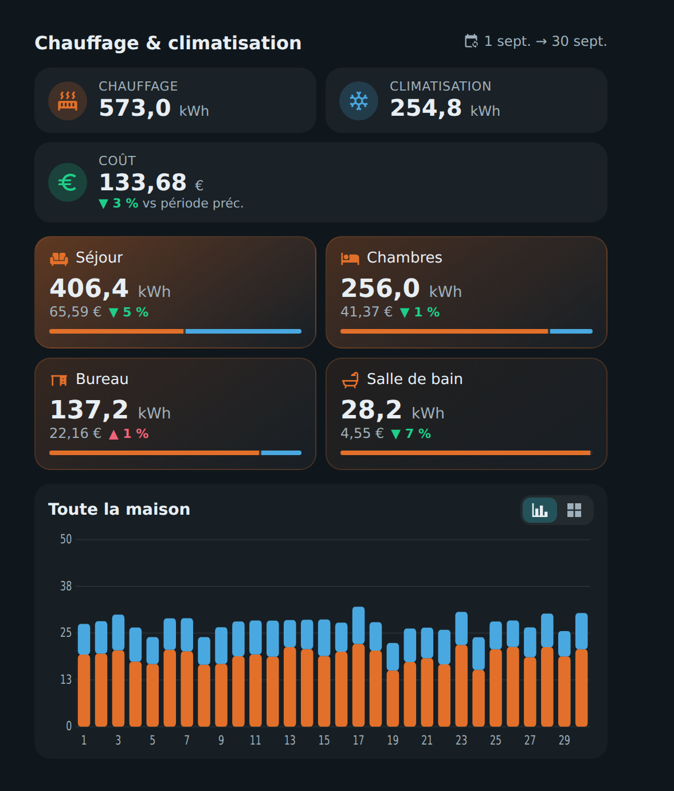
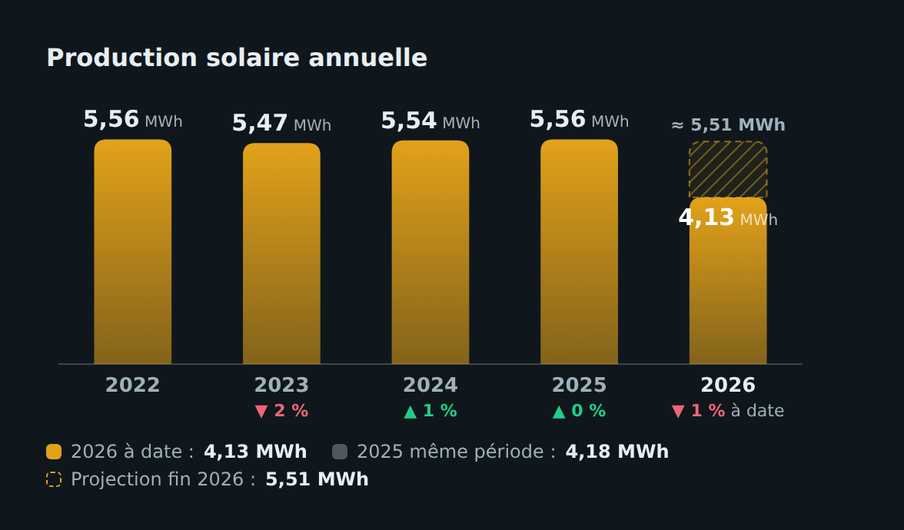
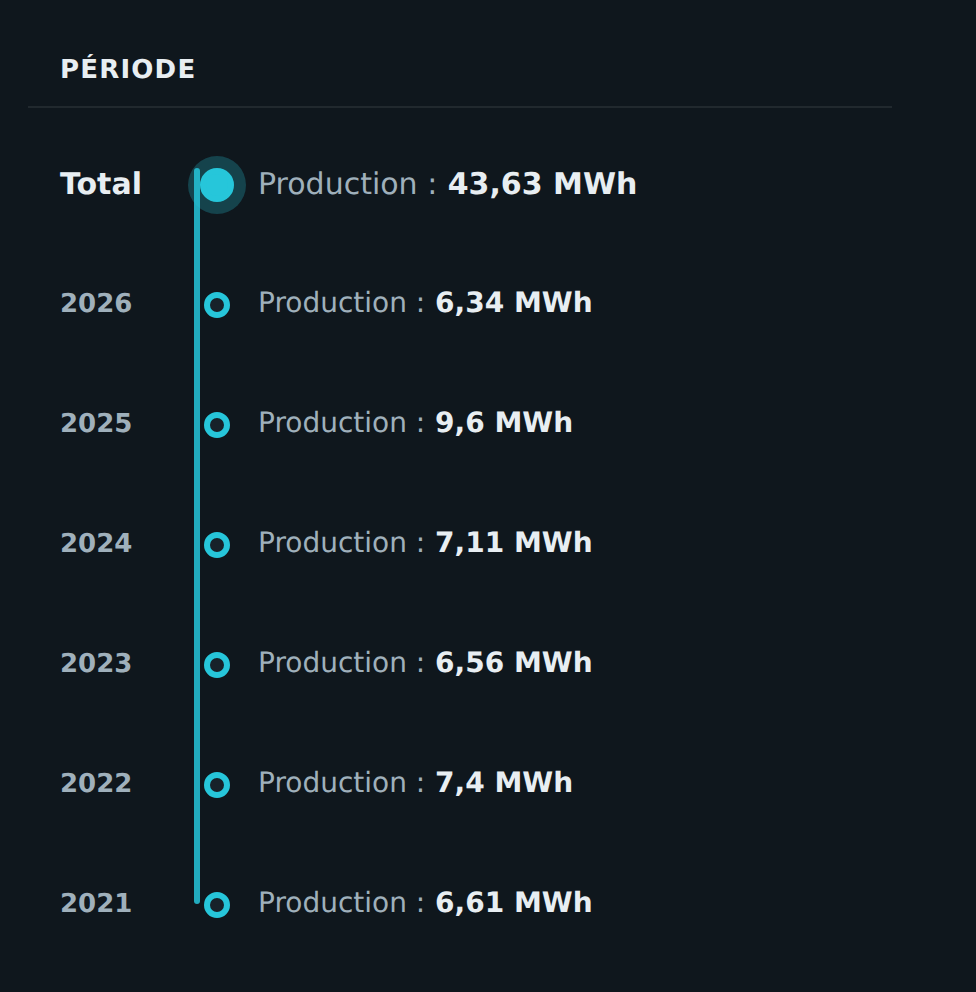

# ⚡ HOLM Energy Cards

[](https://hacs.xyz/)


**Six cartes pour comprendre votre énergie : ce que vous produisez, achetez et revendez, ce que coûte chaque appareil, le chauffage pièce par pièce, et l'évolution année après année.**

HOLM Energy Cards s'appuie sur le **tableau de bord Énergie** de Home Assistant : sources, appareils et prix sont repris automatiquement. Les cartes suivent le **sélecteur de date** du tableau Énergie (jour, semaine, mois, année), comme les cartes officielles.

> ✨ **Un seul fichier, six cartes**, toutes réglables dans l'éditeur visuel (sauf les Totaux annuels, en YAML).

| Carte | Type | Ce qu'elle montre |
|---|---|---|
| [Bilan énergétique](#-bilan-énergétique) | `custom:holm-energy-sources-card` | Production, achat, revente, autoconsommation, autosuffisance, facture estimée |
| [Consommation par appareil](#-consommation-par-appareil) | `custom:holm-energy-devices-card` | kWh, coût et part de chaque appareil, avec le « non mesuré » et un graphique par appareil |
| [Production & consommation](#-production--consommation) | `custom:holm-solar-chart-card` | Graphique énergie (barres) et puissance (courbe) du solaire et du réseau |
| [Chauffage & climatisation](#-chauffage--climatisation) | `custom:holm-climate-energy-card` | Chauffage et clim par pièce, coût, évolution, graphique ou calendrier |
| [Énergie par année](#-énergie-par-année) | `custom:holm-year-bars-card` | Barres annuelles, comparaison « à date » et projection de l'année |
| [Totaux annuels](#-totaux-annuels) | `custom:holm-energy-years-card` | Total et années d'une statistique, en frise verticale |

### 🆕 Nouveautés de la 1.2.2

**🧾 Abonnement et taxes lus dans [HOLM HP/HC](https://github.com/kaaribou/holm-tarif).** Si l'intégration HOLM HP/HC est installée, *Bilan énergétique*, *Consommation par appareil* et *Chauffage & climatisation* y lisent automatiquement l'abonnement mensuel, la CSPE / accise, la TCFE et la taxe sur la revente. Plus besoin de les renseigner dans chaque carte. Les valeurs indiquées dans une carte restent prioritaires, et `holm_tarif: false` désactive la lecture automatique.

**🩹 Plus d'erreur à l'ajout d'une carte.** Une carte tout juste ajoutée (entité pas encore choisie) ou un tableau Énergie pas encore configuré affichaient `Erreur : length of value must be at least 1 at 'statistic_ids'`. La carte affiche maintenant simplement quoi faire.

### Nouveautés de la 1.2.1

**💶 Coûts justes avec Tempo et les prix qui changent.** Les cartes reprennent maintenant les **coûts enregistrés par Home Assistant** pour chaque source du tableau Énergie, calculés heure par heure au prix du moment, comme le tableau Énergie officiel. Avant, quand une source avait une entité de prix, la carte appliquait le prix **actuel** à tout l'historique : avec Tempo (bleu, blanc, rouge) ou après un changement de tarif, les coûts passés étaient faux. Concerne *Consommation par appareil*, *Chauffage & climatisation* et *Bilan énergétique*.

### Nouveautés de la 1.2.0

**🕒 Vue « Dans le temps ».** *Consommation par appareil* peut maintenant afficher tous les appareils dans **un même graphique** : barres empilées par heure, par jour ou par mois, avec **l'icône de l'appareil qui consomme le plus** au-dessus de chaque barre. On voit d'un coup d'œil **qui consomme et quand**.



- survol (ou toucher) d'une barre : détail par appareil ;
- légende cliquable pour masquer ou réafficher un appareil ;
- options `view: timeline` et `timeline_devices` (nombre d'appareils détaillés, les autres sont regroupés).

**💶 Coût juste dans le graphique d'un appareil.** Le coût du graphique (24 h, 7 j, 30 j, 12 mois ou dates au choix) est maintenant recalculé **heure par heure au prix réel** sur la période du graphique, au lieu de reprendre le prix moyen de la période affichée par la carte. Le coût de chaque barre s'affiche au survol. La carte calcule aussi à l'heure jusqu'à 31 jours.

### Nouveautés de la 1.1.0

**📈 Un graphique pour chaque appareil.** Dans *Consommation par appareil*, un toucher sur un appareil ouvre son graphique :

- périodes **24 h · 7 j · 30 j · 12 mois** ou **dates au choix** (du… au…) ;
- **barres de consommation** par heure, par jour ou par mois, et la **courbe de puissance** par-dessus sur 24 h si l'appareil a un capteur de puissance ;
- chiffres clés de la période : **total**, **coût estimé**, **moyenne** et **pic** (avec sa date) ;
- survol (ou toucher) d'une barre pour voir sa valeur ; bouton ⓘ pour la fenêtre d'informations de Home Assistant.

Les données viennent des statistiques long terme de Home Assistant (celles du tableau Énergie) : c'est rapide et ça remonte aussi loin que votre historique.

---

## Installation

### Avec HACS (recommandé)

1. HACS → menu ⋮ → **Dépôts personnalisés**.
2. Ajoutez `https://github.com/kaaribou/holm-energy-cards`, catégorie **Tableau de bord** (*Dashboard / Plugin*).
3. Recherchez la carte → **Télécharger**.
4. Rechargez la page (Ctrl + F5).

### Manuellement

1. Copiez `dist/holm-energy-cards.js` dans `config/www/community/holm-energy-cards/`.
2. **Paramètres → Tableaux de bord → ⋮ → Ressources → Ajouter** : `/local/community/holm-energy-cards/holm-energy-cards.js`, type **Module JavaScript**.
3. Rechargez la page.

> [!NOTE]
> Une seule ressource charge les six cartes. Elles apparaissent ensuite dans le sélecteur de cartes (« HOLM – … »).

---

## 📊 Bilan énergétique



- Production solaire, achats réseau (plusieurs tarifs, ex. heures pleines / creuses) et revente, avec leur coût.
- **Autoconsommation** et **autosuffisance** en anneaux, part consommée sur place et sa valeur.
- **Facture estimée** : énergie achetée + abonnement (proratisé à la période) + taxes − revente.

```yaml
type: custom:holm-energy-sources-card
title: Bilan énergétique
items:
  - type: solar
    entity: sensor.production_solaire
    name: Production solaire
  - type: import
    entity: sensor.linky_hp
    name: Achat heures pleines
    price: sensor.prix_hp            # ou cost_entity: statistique de coût
  - type: import
    entity: sensor.linky_hc
    name: Achat heures creuses
    price: sensor.prix_hc
  - type: export
    entity: sensor.linky_injection
    name: Revente
    price: 0.04
subscription: input_number.abonnement
subscription_period: month
```

| Option | Description | Par défaut |
|---|---|---|
| `items` | Sources : `type` (`solar`, `import`, `export`), `entity` (kWh), `name`, `cost_entity` ou `price`, `color`, `icon` (**obligatoire**) | — |
| `subscription`, `subscription_period` | Abonnement (nombre ou entité) et sa période (`month` / `year`) | HOLM HP/HC si installée |
| `taxes_import` | Taxes ajoutées aux kWh achetés (€/kWh, nombre ou entités) | HOLM HP/HC si installée |
| `tax_export` | Taxe déduite des kWh revendus (€/kWh) | HOLM HP/HC si installée |
| `holm_tarif` | `false` : ne pas lire l'abonnement et les taxes dans HOLM HP/HC | `true` |
| `self_price` | Valeur du kWh autoconsommé | prix moyen d'achat |
| `self_name` | Libellé de l'autoconsommation | `Consommée sur place` |

## 🔌 Consommation par appareil



- Les appareils sont lus dans **Paramètres → Tableaux de bord → Énergie → Consommation individuelle** (ou listés à la main).
- kWh, part et **coût** de chaque appareil, mini-graphe, tri par kWh, € ou nom, « Voir tout ».
- **Non mesuré** : ce que consomme la maison en dehors des appareils suivis.
- Coût **réel** (prix réseau de chaque heure, solaire gratuit), **réseau** (comme si tout venait du réseau) ou **fixe**.
- **Graphique par appareil** : un toucher sur un appareil ouvre sa consommation sur 24 h, 7 j, 30 j, 12 mois ou les dates de votre choix, avec total, coût, moyenne et pic. Le coût est recalculé heure par heure au prix réel sur la période du graphique.
- **Vue « Dans le temps »** (`view: timeline`) : tous les appareils empilés dans un même graphique, avec l'icône de celui qui consomme le plus au-dessus de chaque barre.

```yaml
type: custom:holm-energy-devices-card
title: Consommation par appareil
cost_mode: real
top: 8
```

| Option | Description | Par défaut |
|---|---|---|
| `view` | `list` (liste des appareils) ou `timeline` (« Dans le temps ») | `list` |
| `timeline_devices` | Appareils détaillés dans la vue « Dans le temps » (les autres sont regroupés) | `8` |
| `cost_mode` | `real`, `grid` ou `fixed` | `real` |
| `price` | Prix fixe (mode `fixed`), nombre ou entité | — |
| `taxes_import` | Taxes ajoutées au prix réseau (€/kWh) | HOLM HP/HC si installée |
| `holm_tarif` | `false` : ne pas lire les taxes dans HOLM HP/HC | `true` |
| `top` | Appareils affichés avant « Voir tout » | `10` |
| `sort` | `kwh`, `eur` ou `name` | `kwh` |
| `hide_zero`, `show_unmeasured`, `show_sparkline` | Masquer les appareils à 0, afficher le non mesuré, les mini-graphes | `true` |
| `exclude` | Appareils à ignorer | — |
| `devices` | Liste manuelle : `entity`, `name`, `icon`, `color`, `power` (le capteur de puissance ajoute la courbe au graphique) | appareils du tableau Énergie |

## ☀️ Production & consommation



- Vue **Énergie** : barres par heure (ou par jour) du solaire consommé, du réseau par tarif et de la revente.
- Vue **Puissance** : courbes de production et de consommation, avec la **prévision solaire** si elle est configurée dans le tableau Énergie.
- Taux d'autoconsommation de la période.

```yaml
type: custom:holm-solar-chart-card
title: Production & consommation
mode: energy
```

| Option | Description | Par défaut |
|---|---|---|
| `mode` | Vue par défaut : `energy` ou `power` | `energy` |
| `show_tabs`, `show_forecast` | Onglets Énergie / Puissance, prévision solaire | `true` |
| `solar_power`, `grid_power` | Capteurs de puissance | ceux du tableau Énergie |
| `solar_color`, `self_color`, `export_color`, `grid_colors`, `power_grid_color` | Couleurs | — |

## 🌡️ Chauffage & climatisation



- Totaux chauffage et clim, **coût** et évolution par rapport à la période précédente.
- Une tuile par pièce avec la répartition chauffage / clim.
- Graphique **barres** de toute la maison, ou **calendrier** (carte de chaleur).

```yaml
type: custom:holm-climate-energy-card
title: Chauffage & climatisation
rooms:
  - name: Séjour
    icon: mdi:sofa
    heating: sensor.sejour_chauffage_energie
    cooling: sensor.sejour_clim_energie
  - name: Salle de bain
    icon: mdi:shower
    heating: sensor.seche_serviette_energie
```

| Option | Description | Par défaut |
|---|---|---|
| `rooms` | Pièces : `name`, `icon`, `heating`, `cooling` (kWh) (**obligatoire**) | — |
| `cost_mode`, `price`, `taxes_import` | Calcul du coût (voir Consommation par appareil) | `real` |
| `compare` | Comparer à la période précédente | `true` |
| `view` | `bars` ou `heatmap` | `bars` |
| `heat_color`, `cool_color` | Couleurs | orange / bleu |

## 📅 Énergie par année



- Une barre par année, l'évolution d'une année sur l'autre.
- Année en cours comparée **à date** à la même période de l'an dernier, et **projection** de fin d'année.
- Utilise les statistiques long terme : aucun helper à créer.

```yaml
type: custom:holm-year-bars-card
entity: sensor.production_solaire
title: Production solaire annuelle
start_year: 2022
color: "#e3a21a"
```

| Option | Description | Par défaut |
|---|---|---|
| `entity` | Statistique d'énergie en kWh (**obligatoire**) | — |
| `start_year` ou `years` | Première année, ou nombre d'années affichées | toutes |
| `unit` | `auto`, `kWh` ou `MWh` | `auto` |
| `color` | Couleur des barres | `#0ABFBF` |
| `show_projection` | Projection de l'année en cours | `true` |

## 🧾 Totaux annuels



Une frise verticale : le total depuis le début, puis chaque année. À configurer en YAML.

```yaml
type: custom:holm-energy-years-card
entity: sensor.production_solaire
title: Période
label: Production
```

| Option | Description | Par défaut |
|---|---|---|
| `entity` | Statistique d'énergie (**obligatoire**) | — |
| `title`, `label` | Titre et libellé des valeurs | `Période`, `Énergie` |
| `color` | Couleur de la frise | couleur du thème |
| `start_year` | Première année prise en compte | `2000` |

Toutes les cartes acceptent aussi `show_frame: false` (sans cadre) et, pour celles qui suivent le sélecteur de date, `collection_key` si le tableau de bord en contient plusieurs.

## 💶 D'où viennent les prix ?

Les cartes ne lisent pas vos utility meters ni de tarif à elles : elles reprennent les **sources réseau du tableau Énergie** (Paramètres → Tableaux de bord → Énergie), dans cet ordre :

1. la **statistique de coût** de la source, si vous en avez indiqué une (« entité qui suit le coût total ») ;
2. sinon, le **coût que Home Assistant enregistre** pour la source quand elle a un prix (entité ou nombre) : `sensor.<source>_cost` et `sensor.<revente>_compensation`. Il est calculé heure par heure au prix du moment, donc juste avec Tempo, les heures pleines / creuses ou un changement de tarif ;
3. pour les heures plus anciennes que ce coût enregistré, le prix actuel × kWh.

*Consommation par appareil* et *Chauffage & climatisation* en déduisent un prix du kWh pour chaque heure, appliqué aux kWh de chaque appareil :

- `cost_mode: real` : coût réseau de l'heure ÷ consommation de la maison. Le solaire est gratuit, ce qui fait baisser le prix moyen ;
- `cost_mode: grid` : coût réseau de l'heure ÷ kWh achetés, comme si tout venait du réseau. C'est le mode à choisir pour comparer avec des compteurs par tarif ;
- `cost_mode: fixed` : le prix `price`.

Les **taxes** (CSPE / accise, TCFE) et, dans *Bilan énergétique*, l'**abonnement** et la **taxe sur la revente** viennent des options de la carte ou, à défaut, de [HOLM HP/HC](https://github.com/kaaribou/holm-tarif) si elle est installée.

Dans *Bilan énergétique*, chaque source utilise `cost_entity`, sinon le coût enregistré par Home Assistant pour son entité, sinon `price`. Un `price` fixe (nombre) reste prioritaire sur le coût enregistré.

---

## FAQ

| Problème | Solution |
|---|---|
| Une carte reste sur « aujourd'hui » | Ajoutez une carte **Sélecteur de date énergie** (`energy-date-selection`) dans la même vue. |
| Pas d'appareils ou de sources, ou « Choisissez une entité… » | Choisissez les entités dans l'éditeur de la carte, ou configurez d'abord le **tableau de bord Énergie** de Home Assistant. |
| Les coûts sont à 0 | Indiquez un prix (entité ou nombre) pour vos sources réseau, dans le tableau Énergie ou dans la carte. |
| Les coûts ne correspondent pas à mes compteurs HP / HC | Voir [D'où viennent les prix ?](#-doù-viennent-les-prix-) : en mode `real`, le solaire est compté gratuit ; essayez `cost_mode: grid`. |
| Pas de courbe de puissance dans le graphique d'un appareil | Associez un capteur de puissance à l'appareil (tableau Énergie, ou `power` dans `devices`). |
| La nouvelle version ne s'affiche pas | Videz le cache (Ctrl + F5). |

---

## Un petit merci ?

La carte vous plaît ? Vous pouvez m'offrir une bière 🍺

[](https://paypal.me/kaaribou)

---

## Licence

Code : licence **MIT** — © kaaribou. Voir le [CHANGELOG](CHANGELOG.md).

Fait partie de **HOLM — Home Orchestration & Living Management** : la gestion et l'orchestration intelligente de la maison.

Les autres projets : [Volets HOLM](https://github.com/kaaribou/volets-holm) · [Climat HOLM](https://github.com/kaaribou/climat-holm) · [Carburant HOLM](https://github.com/kaaribou/carburant-holm) · [Commandes à la maison HOLM](https://github.com/kaaribou/commandes-holm) · [HOLM Navbar Card](https://github.com/kaaribou/holm-navbar-card) · [HOLM Climate Card](https://github.com/kaaribou/climate-card-holm) · [HOLM Music Card](https://github.com/kaaribou/holm-music-card) · [HOLM Sentinel Card](https://github.com/kaaribou/holm-sentinel-card) · [HOLM Security Card](https://github.com/kaaribou/holm-security-card) · [HOLM Recordings Card](https://github.com/kaaribou/holm-recordings-card) · [HOLM Covers Card](https://github.com/kaaribou/holm-covers-card) · [HOLM Power Flow Card](https://github.com/kaaribou/holm-power-flow-card) · [HOLM Radiator Card](https://github.com/kaaribou/holm-radiator-card) · [HOLM Floor Card](https://github.com/kaaribou/holm-floor-card) · [HOLM Smoke Card](https://github.com/kaaribou/holm-smoke-card) · [HOLM BG Card](https://github.com/kaaribou/holm-bg-card).
